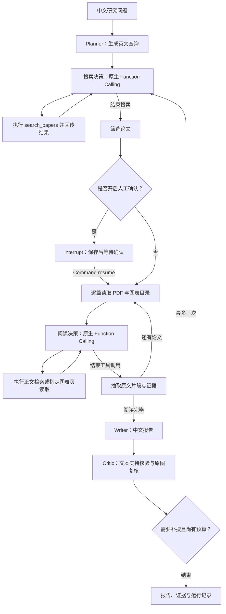

# PaperScout

**面向 AI 研究的论文调研 Agent：自主检索、图表阅读、结论级证据溯源。**

输入一个研究问题，PaperScout 自动检索 arXiv、筛选论文、阅读正文与图表，生成带原文证据和 PDF 页码的中文报告。审阅发现重要缺口时，系统最多补搜一次；仍找不到依据的判断会保留为未知。

项目采用 Python、Streamlit、**LangGraph** 和**原生 Function Calling**。模型选择检索词、正文检索与图表页读取工具；LangGraph 管理流程、补搜分支和 SQLite 检查点，支持中断后恢复与可选的人工论文确认。

[快速开始](#快速开始) · [工作流程](#工作流程) · [模型配置](#模型配置) · [测试与评测](#测试与评测) · [已知边界](#已知边界)

## 核心能力

| 能力 | 实现方式 |
| --- | --- |
| 自主论文检索 | 将中文问题转换为英文查询，搜索 arXiv，按论文 ID 去重并记录筛选理由 |
| 正文与图表阅读 | 按页提取 PDF 文本，使用 BM25 检索相关内容；提取图表页截图、结构化单元格及视觉解读 |
| 结论级引用 | 模型选择程序提供的原文片段编号，程序提取引文并生成证据链接 |
| 双层证据核验 | 检查引用与原文的对应关系，再审阅证据是否支持结论；图表结论额外对照原图复核 |
| 有限自主补搜 | Critic 根据证据缺口选择结束或补搜，执行器限制轮数和论文数量 |
| 原生工具调用 | 通过 Chat Completions 的 `tools` / `tool_calls` / `tool_call_id` 完成请求、校验、执行和结果回传 |
| 持久化与人工确认 | SQLite 保存每个节点的状态；失败后恢复，可在阅读前调整入选论文 |
| 可追溯输出 | 展示检索词、来源、阅读限制、核验状态、调用次数、token 用量及停止原因 |
| 可携带证据包 | 下载 Markdown 报告、JSON 运行记录，以及包含原图的 ZIP 证据包 |

### 三个关键设计

**1. 引文由程序提取，模型负责选择。**

程序为连续原文片段分配 `span_id`。模型返回片段编号和判断，程序从对应字符区间取回原文，避免模型在复制引文时改写数字、遗漏限定条件或拼接不连续句子。不存在的编号会被拒绝。

**2. “原文存在”和“原文支持结论”分开核验。**

一段引文可以真实存在，却不足以支持某个判断。Critic 读取结论与证据，给出 `supported`、`partial` 或 `insufficient`；图表相关结论还会对照原始截图核验行列、单位、图例和趋势。模型核验结果仍可能有误。

**3. 补搜有明确预算，停止也有理由。**

系统允许一次审阅驱动的补搜。重复查询、无效查询或用尽预算时停止，并保留剩余缺口。检索请求失败与“没有找到相关论文”分别记录。

## 工作流程



这些步骤由 `StateGraph` 的节点和条件边运行。每个工具执行、单篇阅读、抽取、写作与审阅节点完成后，使用 SQLite 同步保存检查点；当前执行位置和工具返回值可以跨 Python 进程恢复。

搜索优先使用 arXiv API；请求失败时尝试 arXiv 官方网页搜索。两个入口都不可用时，系统保留失败记录，不将网络故障解释为研究不存在。

| 执行预算 | 当前限制 |
| --- | --- |
| 初始查询 | 最多 2 条，每条最多 5 篇候选 |
| 初始阅读 | 最多 3 篇论文 |
| 补充检索 | 最多 1 次，新增最多 2 篇论文 |
| 图表阅读 | 每篇默认 3 个候选页，可调整为 1–6 页或关闭 |
| 单篇工具预算 | 最多 8 次工具尝试、6 次模型决策；正文检索最多 2 次，重复请求复用结果 |
| 抽取上下文 | 每篇最多 4 个正文块和 4 个图表块 |
| PDF 处理 | 单文件最多 25 MB、80 页 |

### 原生工具调用如何执行

文本模型收到 `tools` 定义后返回真实 `tool_calls`，执行器按工具名称与 Pydantic 参数契约校验，执行后通过 `role="tool"` 和对应的 `tool_call_id` 回传结果。DeepSeek 返回的 `reasoning_content` 在后续工具对话中保留。

| 工具 | 参数与执行边界 |
| --- | --- |
| `search_papers` | 英文 `query`，每次最多返回 5 篇候选；只在搜索阶段开放 |
| `retrieve_passages` | 当前 `paper_id` 与 `query`，用 BM25 获取相关正文或已读取的图表片段 |
| `read_visual_page` | 当前 `paper_id` 与候选 `page`，读取指定图表页并保留原图 |

未知工具、额外参数、未选论文、越界页码和超预算调用会返回工具错误，无法绕过执行器。无效调用也消耗预算。每条调用的参数、结果、耗时和缓存命中信息写入运行记录。

规划、筛选、证据抽取、写作与 Critic 继续使用校验后的结构化输出；由图的条件边决定进入下一阶段或补搜。没有把所有 JSON 输出都称为 Function Calling。

## 快速开始

### 1. 安装依赖

克隆本仓库并进入项目根目录。项目已在 Python 3.13 的 Conda 环境中验证：

```bash
# 已有 deepresearch_py313 环境时，跳过创建步骤
conda create -n deepresearch_py313 python=3.13 -y
conda activate deepresearch_py313
python -m pip install -r requirements.txt
```

### 2. 配置模型

首次使用时参考 [.env.example](.env.example) 创建 `.env`。已有配置无需覆盖。

以下为 DeepSeek 配置示例，将密钥替换为自己的值：

```dotenv
LLM_PROVIDER=deepseek
DEEPSEEK_API_KEY=your_deepseek_api_key
DEEPSEEK_MODEL=deepseek-flash
DEEPSEEK_BASE_URL=https://api.deepseek.com

VISION_ENABLED=true
VISION_MODEL=deepseek-flash
VISION_MAX_PAGES=3
```

文本模型需要同时支持 JSON 输出与 Chat Completions 原生工具调用，视觉模型需要支持图片输入。模型名称和访问权限以自己的服务账户为准。`.env` 已加入 Git 忽略规则，不要将实际密钥写入源码或提交到仓库。

### 3. 启动应用

```bash
python -m streamlit run app.py
```

打开终端提示的本地地址，输入研究问题即可开始。首次检索与 PDF 下载需要联网；远程模型调用可能产生费用，耗时取决于论文规模、视觉页数和服务响应。

## 使用示例

页面提供三个预置研究问题，也可以输入自己的问题：

> 连续潜在推理有哪些方法？现有证据能否支持它改善组合泛化？

> 多模态大模型如何使用视觉信息进行多步推理？有哪些评测与限制？

> 推理时增加计算量与训练连续思维各有什么收益？哪些结果可以直接比较？

一次调研完成后，可以通过四个标签页检查结果：

| 标签页 | 内容 |
| --- | --- |
| 研究报告 | 核心回答、分问题分析、相关论文发现与适用条件、分歧和未知、待验证实验 |
| 原文证据 | 按回答引用／全部／未采用筛选；展示原文、关联中文判断、支持关系、条件和页码 |
| 图像与表格 | 原图、视觉解读、结构化表格及关联结论；支持关键词和“只看回答引用”筛选 |
| 调研过程 | 查询、阅读、审阅、补搜和停止事件，以及模型调用与用量记录 |

### 回答与证据如何组织

报告首先直接回答问题，再展示分问题分析、关键论文对比、分歧与未知、待验证实验。核心回答复用 Writer 提出的、经过 Critic 和必要原图复核后的结论，不增加一段未经核验的总结；`partial` 始终保留限定，`insufficient` 和 `unreviewed` 不进入核心回答。

Writer 用 `priority` 标记直接回答问题的结论，用 `focus` 分组子问题，用 `scope` 记录证据能够支持的实验条件。Critic 同时审阅判断与条件，并在 `evidence_assessments` 中注明每段证据是支持、限制、反驳还是背景。关系注释只允许引用当前结论已关联的证据；文本审阅关系与最终原图复核状态分别展示，后者不会被旧的“支持”注释覆盖。

点击正文证据编号可以定位到折叠卡片，展开后查看原文与关联中文判断，并返回对应结论。中文判断不是逐字翻译。未采用的片段和未获支持的说法仍保留在附录，图表显示关联证据和识别限制；图片哈希移到调研过程及 ZIP 校验清单。

待验证方向关联已有材料，并要求提供支持／否定实验假设的判据。它们仍是尚未独立核验的实验建议，不作为已证明的研究缺口。旧记录没有新字段时保留空缺，不补造条件或证据关系；页面使用新版模板重新排版，无需重新调用模型。三种下载均保留证据，Markdown 包含完整附录及双向引用。

### 保存、确认与恢复

- 每次调研分配一个 `run_id`，检查点默认保存到 `.cache/paperscout/checkpoints.sqlite`。重启 Streamlit 后，侧栏“已保存的调研”仍可查看任务。
- 运行被异常中断时，点击“恢复本次调研”或侧栏“从检查点继续”。已完成且保存的节点不再执行。
- 开启“阅读前确认论文选择”后，筛选完成即暂停；可以更改候选论文，再点击“确认论文并继续”。补搜筛选也经过相同确认点。默认关闭，保留自主运行。
- 恢复使用原任务的论文、预算与模型配置。切换模型或服务地址后，请新建任务；轮换同一服务的 API key 可以继续恢复。
- 正常结束后的未知结论、局部抽取降级，以及已耗尽预算的检索失败，不会自动无限重试；需要重新调研时新建任务。

也可使用同一个持久化工作流的命令行入口：

```bash
python -m scripts.research run "多模态模型如何进行多步推理？" --visual-pages 1 --approve-papers
python -m scripts.research list
python -m scripts.research resume <run_id> --papers <候选arXiv_ID>
# 恢复失败步骤时，不带 --papers
python -m scripts.research resume <run_id>
```

通过进程环境变量 `PAPERSCOUT_CHECKPOINT_DB` 可指定其他数据库路径。恢复依赖本地数据库与论文／图表缓存；导出的 JSON 是报告记录，不能单独替代检查点。

### 删除已保存的调研

在侧栏“已保存的调研”中选择记录，展开“删除所选调研”。页面先显示预计清理的文件数量、类型、大小以及需要保留的共享缓存；勾选确认后，点击“删除记录与关联缓存”。

- 默认删除所选记录、恢复检查点，以及关联的论文文本、PDF、图片、检索结果和图表解读缓存。删除后不能从检查点恢复。
- 其他调研仍引用的缓存会保留；正在执行调研或清理缓存时，删除入口暂时不可用，请等待执行结束。
- 取消“同时清理关联论文、PDF 和图片缓存”，可以仅删除记录和检查点。已经下载到其他位置的 Markdown、JSON、ZIP 文件不受影响。
- 新调研会在缓存目录的 `.runs/` 下记录缓存关联；旧记录按论文、查询和图表内容识别缓存，无法可靠关联的历史文件会保留。预览中的空间仅统计缓存文件，不包含 SQLite 数据库空间。

命令行也可以先预览再删除：

```bash
python -m scripts.research delete <run_id>               # 仅预览
python -m scripts.research delete <run_id> --yes         # 删除记录和独占缓存
python -m scripts.research delete <run_id> --yes --keep-cache  # 仅删除记录
```

删除时会重新检查共享关系，避免使用过期预览。若文件清理或数据库写入失败，记录会保留以便重试；已清理的缓存不会自动恢复。

适合演示的顺序是：**提出问题 → 查看入选论文 → 打开结论的原文 → 核对图表 → 检查支持状态与停止理由 → 下载证据包。** 是否补搜由实际审阅结果决定，并非每次都会触发。

### 下载内容

- **Markdown**：中文报告、证据锚点及论文页码链接。
- **JSON**：论文、文本块、证据、结论、审阅前草稿和完整运行记录。
- **ZIP**：报告、运行记录、原始 PNG、图表结构化 JSON 和图片校验清单；包内使用相对图片路径。

单独下载 JSON 不包含图片字节；需要离线保存图表证据时，请下载 ZIP。

## 模型配置

支持 DeepSeek、Groq 和 Ollama。文本与视觉可以使用同一服务，也可以分别配置。

<details>
<summary>Groq 配置示例</summary>

```dotenv
LLM_PROVIDER=groq
GROQ_API_KEY=your_groq_api_key
GROQ_MODEL=qwen/qwen3.8-27b

VISION_ENABLED=true
VISION_MODEL=qwen/qwen3.8-27b
VISION_MAX_PAGES=3
```

未单独设置视觉接口时，视觉请求复用 Groq 的服务地址和 `GROQ_API_KEY`。服务商配额仍适用于文本与视觉请求。

</details>

<details>
<summary>Ollama 配置示例</summary>

先在本地安装 Ollama，并下载所选模型，例如 `ollama pull llama3.1`。

```dotenv
LLM_PROVIDER=ollama
OLLAMA_MODEL=llama3.1
OLLAMA_BASE_URL=http://localhost:11434/v1
VISION_ENABLED=false
```

此示例使用文本模型。需要图片理解时，应另行配置支持图片输入的模型。Ollama 仅让推理运行在本地，arXiv 检索和首次 PDF 下载仍需联网。

</details>

### 单独配置视觉服务

```dotenv
VISION_ENABLED=true
VISION_MODEL=your_vision_model
VISION_BASE_URL=https://your-compatible-service/v1
VISION_API_KEY=your_vision_api_key
VISION_MAX_PAGES=3
```

视觉接口需兼容 Chat Completions 的图片输入。未指定 `VISION_BASE_URL` 时复用文本服务地址；同一地址下可复用文本密钥。使用不同地址时，需要明确提供对应的 `VISION_API_KEY`。

配置优先级为：**项目 `.env` → 进程环境变量 → Streamlit Secrets**。页面重新运行时加载配置，已开始的调研保持原配置；修改后刷新页面，让下一次调研使用新配置。侧栏显示实际服务、模型及视觉密钥来源，不显示密钥内容。

## 技术实现

| 层次 | 技术与职责 |
| --- | --- |
| 界面 | Streamlit，中文交互、事件展示与下载 |
| 编排 | LangGraph `StateGraph`、条件边、有界循环、`interrupt` / `Command` 人工确认 |
| 持久化 | `langgraph-checkpoint-sqlite`、SQLite 检查点、FileLock 防止同一任务并发恢复 |
| 模型接口 | OpenAI Python SDK，兼容 Chat Completions 的服务与原生 Function Calling |
| 结构化输出 | Pydantic，校验模型决策及共享数据记录 |
| 论文检索 | HTTPX、arXiv API、Beautiful Soup 网页结果解析 |
| 正文检索 | pypdf 按页提取，BM25 检索相关文本块 |
| 图表阅读 | PyMuPDF 页面渲染与表格提取，多模态模型解读与复核 |
| 缓存与导出 | 本地文件缓存、Markdown、JSON、ZIP |
| 测试 | pytest、模拟外部服务及 Streamlit AppTest |

正文证据的追溯关系为：

```text
结论 → evidence_id → 原文片段 → 文本块 → 论文版本与 PDF 页码
```

图表证据还关联原始截图、图片及 PDF 的 SHA-256。图表转录和中文解释与正文逐字引文分开标注；没有可用原图或视觉服务时，不能仅根据转录确认图表结论。

缓存默认位于 `.cache/paperscout/`，可通过 `PAPERSCOUT_CACHE_DIR` 修改。搜索与视觉解读缓存有效期为 24 小时；版本化 PDF 文本可长期复用。arXiv 请求带超时、请求间隔和有限重试。

## 项目结构

```text
.
├── app.py                       # Streamlit 入口
├── research_agent/
│   ├── agents.py                # 规划、筛选、片段选择、写作和审阅
│   ├── orchestrator.py          # 公共入口、证据校验与旧版基线
│   ├── graph.py                 # LangGraph 节点、条件边、预算与恢复
│   ├── tool_calling.py          # 原生工具 schema、参数契约与结果消息
│   ├── checkpoints.py           # SQLite 检查点路径与任务索引
│   ├── deletion.py              # 删除预览、共享检查与记录清理
│   ├── cache_lifecycle.py       # 每次调研的缓存关联与使用锁
│   ├── tools.py                 # arXiv 请求、下载和文件缓存
│   ├── search.py                # 查询规范化与网页搜索回退
│   ├── reader.py                # PDF 文本、BM25 与原文片段
│   ├── visuals.py               # 图表页读取与原图核验
│   ├── models.py                # 数据结构与模型输出契约
│   ├── llm.py                   # 模型客户端与用量记录
│   ├── config.py                # 配置读取与运行期间的固定配置
│   ├── report.py                # 报告和引用生成
│   └── artifacts.py             # 合并表格展示与 ZIP 证据包
├── eval/                        # 案例、组件验证与人工评测工具
├── scripts/                     # 命令行运行／恢复与联网组件检查
├── tests/                       # 离线回归测试
├── .env.example
└── requirements.txt
```

## 测试与评测

### 离线测试

```bash
python -m pytest -q
```

当前版本 **137 项离线测试通过**：原有 71 项回归继续覆盖检索回退、去重与缓存、正文／图表读取、原文片段选择、无效引用拒绝、原图核验降级、局部抽取失败恢复、补搜上限、配置刷新和界面下载。

编排升级新增 30 项测试覆盖原生工具协议、DeepSeek 推理字段保留、参数与阶段白名单、图表页工具选择、缓存去重、预算控制、SQLite 断点恢复、独立进程恢复、人工确认、并发恢复保护及 Streamlit 恢复入口。旧版手写编排保留为 `run_research(..., engine="legacy")`，用于回归对照；页面与评测默认使用 LangGraph。

报告升级另有 14 项测试，覆盖核心回答的核验约束、证据反向关联、未知信息保留、旧记录兼容、页面筛选，以及 Markdown／JSON／ZIP 引用一致性。

记录删除另有 22 项测试，覆盖历史缓存识别、共享文件保留、运行中拒绝清理、失败后重试、检查点清理、缓存关联持久化、路径隔离，以及页面与命令行的确认和预览。

这些测试验证工程行为，不等同于真实论文结论的正确率。

可单独验证服务是否支持原生工具调用：

```bash
python -m scripts.smoke_function_calling
```

此检查调用文本模型两次、实际搜索 arXiv 一次，验证调用 ID 对应及工具结果回传；它不是完整论文调研或视觉识别评测。

### 联网案例与人工评测

```bash
# 运行一个预置案例；--case all 可运行全部三个案例
python -m eval.evaluator run --case multimodal_reasoning --output eval/runs/demo

# 从本批运行中导出最多 20 条待人工标注记录
python -m eval.evaluator prepare eval/runs/demo/*.json \
  --output eval/runs/annotations.csv

# 人工填写标签后计分
python -m eval.evaluator score eval/runs/annotations.csv
```

评测固定同一份 Writer 草稿与证据，对比直接输出和经过核验约束后的肯定断言。记录有依据结论占比、无依据断言数和有效回答数量，避免只靠删除内容提高正确率。请选用同一批、同一模型的运行记录，并独立核对原文与图表。

工具不会自动填充人工标签；没有人工标注时，不报告准确率提升。当前评测属于小规模案例分析，不作为通用性能证明。详细流程见 [评测说明](eval/README.md)。

运行产物保存到 `eval/runs/`，论文缓存保存到 `.cache/`，均不随源码提交。联网评测会调用已配置的模型。

## 常见问题

| 现象 | 说明与处理 |
| --- | --- |
| arXiv 返回 HTTP 406 | 系统会尝试官方网页搜索；若两个入口均失败，检查网络或稍后再试 |
| 页面显示旧模型 | 刷新页面，检查项目 `.env` 的优先级；旧报告仍保留当时的模型信息 |
| 模型返回 404 | 检查服务商、完整模型名称和账户访问权限 |
| 模型返回 429 | 属于服务商配额限制；等待恢复或调整调研规模，当前未实现 Groq 专用配额调度 |
| 某条证据被拒绝 | 查看片段编号、论文、页码和文本块；无效引用不会进入肯定结论 |
| 原生工具调用不受支持 | 更换支持 Chat Completions `tools` 的文本模型；失败会保留检查点，不会静默降级为伪工具 JSON |
| 任务等待论文确认 | 查看侧栏历史记录或恢复任务，确认候选后继续 |
| 删除提示有调研正在执行 | 等待调研结束，再展开删除入口；正在使用的缓存不会被强制清理 |
| 报告显示“部分完成” | 仍有证据缺口、读取限制或局部错误，查看各条结论的支持状态 |
| PDF 只能读取摘要 | 下载失败、文件超限或没有可用文本；摘要不会被用于补造实验细节 |

## 已知边界

- **覆盖范围有限**：当前仅检索 arXiv；阅读全文文本的解析不代表模型逐字审阅全部内容，只读取预算内的相关块和图表页。
- **复杂图表可能识别错误**：支持图像、曲线、多级表头及合并单元格，但密集小字、模糊扫描和复杂布局仍需人工核对；不自动拼接跨页表格。
- **证据存在不保证推断正确**：视觉转录不等于作者原文，模型给出的支持标签也不等于人工确认。
- **实验分数不可随意横向排名**：不同数据集、划分和训练预算下的结果必须保留条件。
- **研究方向不等于新颖性证明**：报告中的 Gap 仅是本次检索范围内的待验证方向。
- **恢复粒度为节点**：进程在节点执行中退出时，该节点会重跑；已经发往服务但尚未保存的请求可能重复计费。检查点不承诺网络请求恰好执行一次。耗时不包含进程关闭或等待人工确认的时间，硬退出前尚未落盘的用量可能缺失。
- **本地持久化**：检查点包含问题、论文片段、模型工具对话和返回值，不保存客户端与 API key；数据库不加密，适用于个人本地使用。不要提交 `.cache/`，删除前确认不再需要恢复。
- **用量统计有边界**：调用数按应用层请求统计，不单独计算 SDK 内部重试；服务未返回 token 时不估算。
